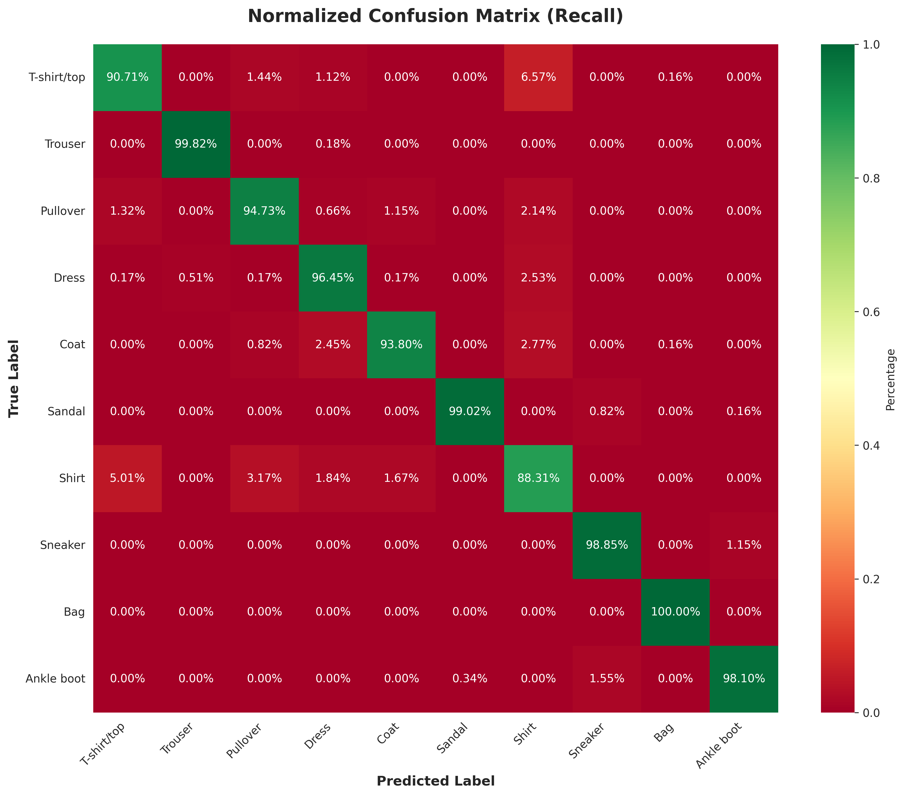
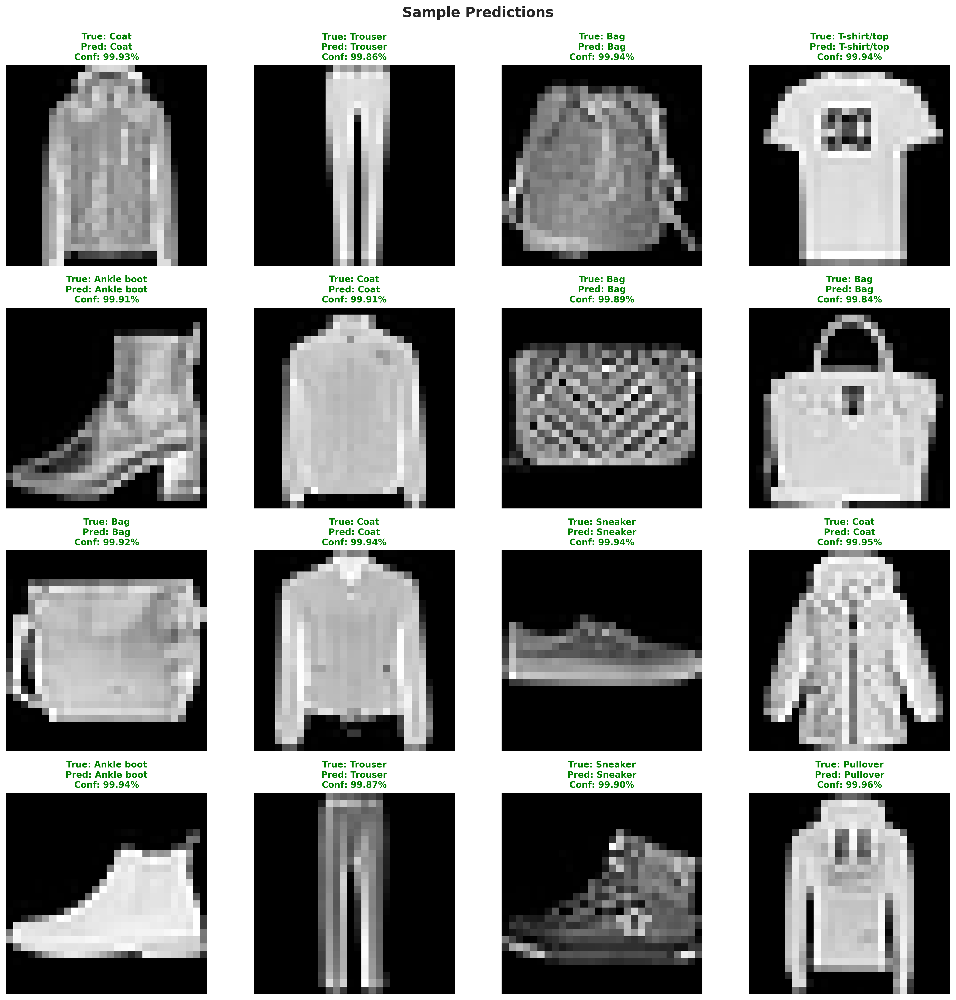

# Fashion-MNIST Classification with WideResNet

基于 **PyTorch** 与 **WideResNet-28-10** 的 Fashion-MNIST 图像分类项目，包含数据增强、TTA 推理、混淆矩阵、分类指标和错误样本分析。

> Fashion-MNIST image classification with WideResNet-28-10, data augmentation, test-time augmentation and visual error analysis in PyTorch.

## 项目亮点

- 使用 WideResNet-28-10 完成 10 类服饰图像分类。
- 主训练脚本使用 Random Erasing、SGD 和分阶段学习率衰减。
- 提供 Cutout + Label Smoothing 实验版训练脚本。
- 提供普通推理、TTA 推理和 10 次 TTA 推理。
- 包含混淆矩阵、类别指标、置信度分布、样本预测和错误分析图。

## 实验结果

| 模型 | 数据划分 | 最佳验证准确率 | 最佳 Epoch |
| --- | --- | ---: | ---: |
| WideResNet-28-10 | 训练 CSV 的 90% / 10% 固定划分（seed=42） | **95.52%** | **173** |

这是单次固定划分上的验证集结果，不是 Fashion-MNIST 官方测试集成绩。





## 数据集

[Fashion-MNIST](https://github.com/zalandoresearch/fashion-mnist) 包含 60,000 张训练图像和 10,000 张测试图像，每张图像为 28×28 灰度图，共 10 个类别。

本仓库不重复分发数据集。请从官方项目或作业所用的数据源获取 CSV，并将以下文件放在仓库根目录：

```text
fashion-mnist_train.csv
fashion-mnist_test_no_gt.csv
```

训练 CSV 的第一列为类别标签，其余 784 列为展平的像素；推理 CSV 不含标签列。

## 项目结构

```text
.
├── train_fashion_mnist.py          # WideResNet 主训练脚本
├── train_cutout_label_smoothing.py # Cutout + Label Smoothing 实验版
├── inference.py                    # 单模型推理
├── inference_tta.py                # TTA 推理
├── inference_tta10.py              # 10 次 TTA 推理
├── generate_analysis_plots.py       # 评估与可视化
├── assets/                          # 实验图表
├── results/                         # 提交文件示例
├── requirements.txt
└── LICENSE
```

## 环境安装

```bash
python -m venv .venv
```

Windows PowerShell：

```powershell
.\.venv\Scripts\Activate.ps1
pip install -r requirements.txt
```

macOS / Linux：

```bash
source .venv/bin/activate
pip install -r requirements.txt
```

## 训练

```bash
python train_fashion_mnist.py
```

最佳权重默认保存为 `best_model.pth`。训练默认配置为 200 epochs、batch size 128、SGD（momentum 0.9）。

实验版：

```bash
python train_cutout_label_smoothing.py
```

## 推理

```bash
python inference.py
python inference_tta.py
python inference_tta10.py
```

脚本会读取 `best_model.pth` 和 `fashion-mnist_test_no_gt.csv`，并生成预测 CSV。

## 分析与可视化

```bash
python generate_analysis_plots.py
```

脚本会基于验证集和模型权重生成分析图。只有当根目录存在真实的 `training_history.csv` 时才绘制训练曲线，不会生成模拟成绩。

## 大文件说明

训练好的 `best_model.pth` 约 292 MB，超过 GitHub 普通仓库的单文件限制，因此没有直接放入源码仓库。如需公开权重，可以将它作为 GitHub Release 附件发布，或使用 Git LFS。

## 已知限制

- 当前结果来自单次固定训练/验证划分，尚未进行多随机种子统计。
- 训练、推理和分析脚本中包含重复的模型定义，后续可拆分到共享模块。
- 具体速度和数值结果会受 PyTorch 版本、GPU 和 CUDA 环境影响。

## License

项目代码使用 [MIT License](LICENSE)。Fashion-MNIST 数据集的许可与归属信息请参见其[**官方仓库**](https://github.com/zalandoresearch/fashion-mnist)。
